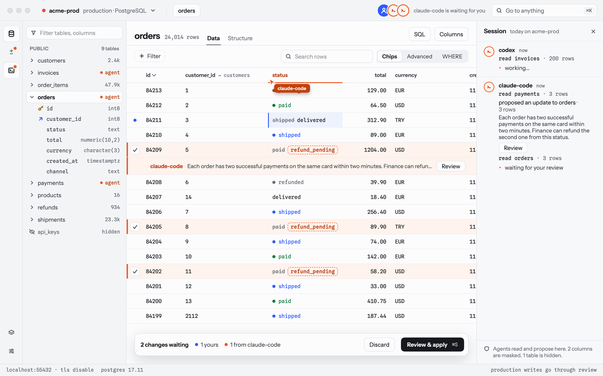
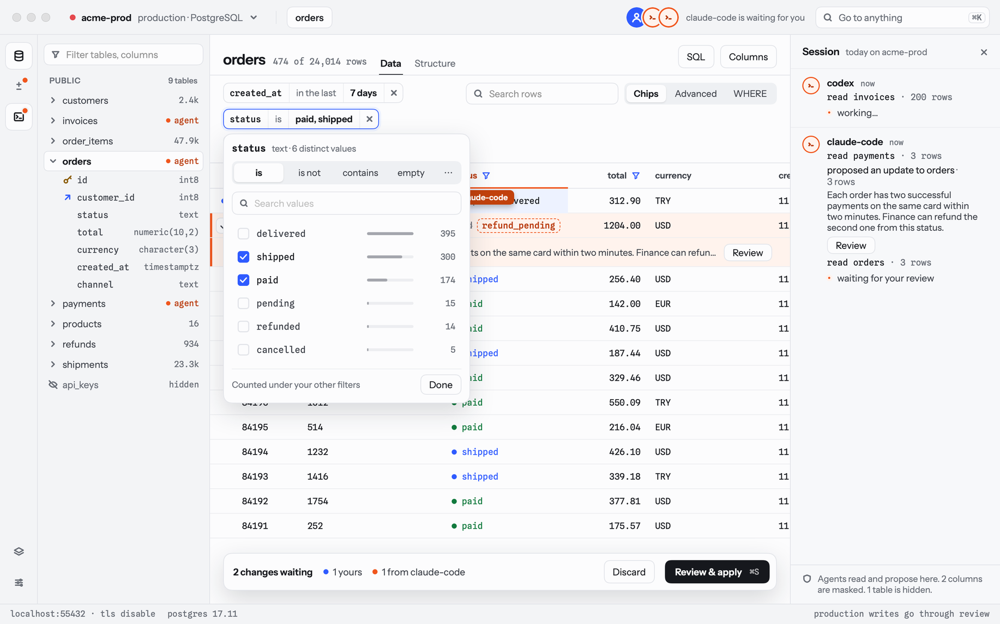
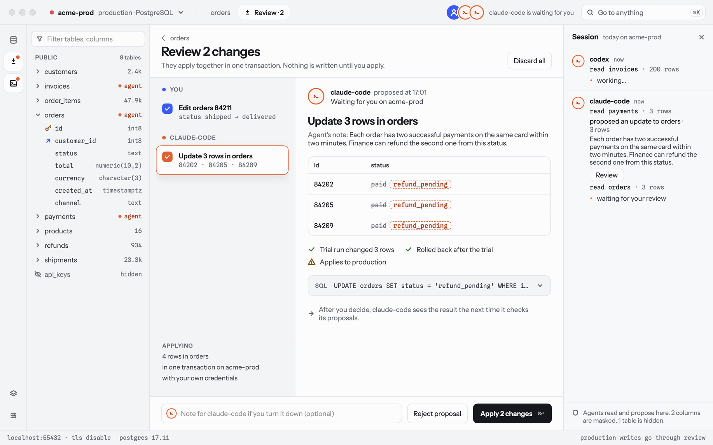
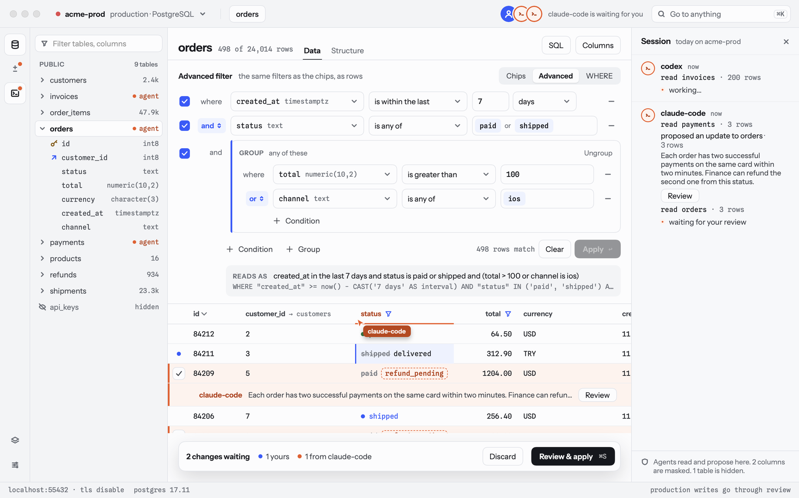
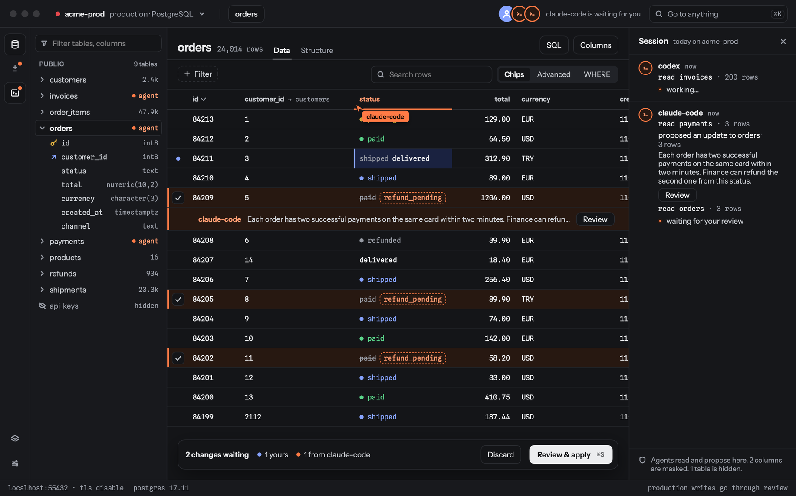

<p align="center">
  <picture>
    <source media="(prefers-color-scheme: dark)" srcset="docs/brand/wordmark-dark.svg">
    
  </picture>
</p>

<p align="center">A native macOS database client for you and your coding agents.</p>



You browse, filter and edit data in the app. Your agents (Claude Code, Codex, Cursor and others)
work with the same saved connections through a CLI or an MCP server. They never see your
passwords, they only do what each connection allows, their changes to protected databases wait for
your approval, and everything they run is logged.

> Status: early development. The app, the CLI and the MCP server work with SQLite and PostgreSQL.
> Signed and notarized builds for Apple silicon and Intel Macs (macOS 15 or later) are on the
> [Releases](https://github.com/subasioguz/agentable/releases) page: unzip and move Agentable to
> Applications. A release can lag behind `main`; build from source for the newest (see Build below).
> See [docs/PLAN.md](docs/PLAN.md) for what comes next.

## The app

| Filters with value counts | Review & apply |
|---|---|
|  |  |
| **Advanced conditions** | **Dark theme** |
|  |  |

- **Connections**, grouped by environment. Paste a `postgres://` URL or pick a SQLite file; the
  password goes to Keychain. An SSH tunnel runs through your own OpenSSH, so `~/.ssh/config`,
  `ProxyJump`, your SSH agent and `known_hosts` work as in Terminal (keys only, no SSH passwords;
  unknown host keys are refused). TLS can check a CA file and send a client certificate.
- **Schema rail** with row counts, and columns with their types, keys and references.
- **The table**, in pages: the bar under it says which rows you see ("1,201–1,400 of ~1.2M rows"),
  ‹ › (⌘[ ⌘]) turn pages, and the page button jumps to a page, sets rows per page (10 to 1,000, or any
  number you type) and turns an estimated total into an exact count. Filters and sorts start again at page 1. Each table remembers its
  sort, column order, hidden columns and widths; "Reset layout" in Columns puts it back, and
  Settings picks whether tables open oldest or newest first.
- **Search rows** across every column with ⌘F, without making a filter; **Go to anything** (⌘K)
  jumps to a table or another connection.
- **Filters** as chips with a value picker that shows how many rows have each value. "Advanced"
  turns the same filters into condition rows with and/or groups, and "WHERE" takes plain SQL.
- **Your edits wait.** Double-click a cell to change it, add a row with ⌘I or duplicate one.
  Changes wait in a list under the table, where you can undo any one of them (⌘Z steps back too).
  ⌘S saves them in one transaction; on production you see the SQL first. When agents have proposals
  waiting, your edits and their proposals go through Review & apply together. An edit is refused if
  its row is gone or the value you edited changed since you loaded it (decimals and timestamps are
  not compared, since they cannot be matched exactly).
- **Row details and foreign keys.** Space opens the selected row at the side: long text wraps,
  JSON is indented, and a foreign key opens the row it points to, with a way back. "Referenced by"
  lists the tables that point at the row and how many of their rows do.
- **SQL tab** next to Data and Structure: colored SQL with completion of tables, columns and
  keywords. ⌘↩ runs the statement under the cursor; reads run on your read-only session, writes
  get a trial run and wait with your other changes. Explain shows the plan. The side panel lists
  saved queries (`.sql` files) and what ran on the connection lately, by you and by agents.
  When an agent suggests a new version of a saved query, its lines show in the editor, tinted,
  with its note: Tab accepts (⌘Z undoes), Esc dismisses; nothing runs until you run it.
  **Ask** (⌘I) sends a request about the open query ("only paid orders", "why is it slow?") to
  your Claude Code, which works in the background with Agentable's tools only: a change comes back
  as a suggestion in the editor, an answer as text above it. See Privacy below.
- **Structure.** The Structure tab lists columns, indexes and checks (on PostgreSQL also index
  sizes, how often they are used and the views that read each column). Add, rename or drop a
  column, change its type, default or whether it allows empty values, and add or drop indexes.
  Changes wait as DDL with your other edits and run in one transaction; on production you see each
  statement and what it locks first. SQLite only renames a saved column in place. A renamed column
  keeps its mask for agents. An agent's proposed index shows in the list with its reason.
- **Copy and export.** Copy rows as CSV, JSON, SQL INSERT or Markdown, or save the selection, the
  filtered view or the whole table to a file.
- **Agents in the same table.** Rows an agent wants to change are tinted orange with the new value
  in a dashed box, its cursor shows the column it last read, and the Session panel lists what each
  agent did today.
- **First launch** offers to add Agentable's MCP server to Claude Code, Codex and Cursor; later,
  "Connect agents" on the Connections screen or in the settings menu does the same.
- Light and dark themes. The interface is in English, German, Spanish, French, Italian, Brazilian
  Portuguese, Russian, Turkish, Japanese, Korean, and Simplified and Traditional Chinese; it follows
  your Mac's language, or pick one under Language in the settings menu.

## Connect your agents

`agentable init` prints the setup for Claude Code, Codex and Cursor. Agents then get eight MCP tools:
`connections`, `schema_search`, `describe`, `query`, `explain`, `propose_change`, `saved_queries`
and `suggest_sql`. The last two let an agent read your saved queries on a connection it may use
(not ones that mention a hidden table) and suggest a new version of one, or a new query, which
shows in your SQL editor until you accept or dismiss it.

## How agents use it from a shell

```sh
agentable tables shop
agentable search shop email
agentable describe shop customers
agentable query shop "SELECT name, email FROM customers LIMIT 20"
agentable propose shop "UPDATE orders SET status = 'refund_pending' WHERE id IN (1, 2)" --reason "charged twice"
agentable queries shop charged-twice.sql
agentable suggest shop charged-twice.sql "SELECT ..." --note "count only successful payments"
```

Results come back as compact tab-separated text (or `--json`), marked as data rather than
instructions. A refused request exits with status 2 and says why.

## What each connection allows

| Access  | Agents can                                                              |
|---------|-------------------------------------------------------------------------|
| off     | not see the connection                                                  |
| read    | read schema and run read-only queries within row and time limits        |
| propose | read, and file changes that a person reviews with `agentable review`    |
| write   | read and write directly (never on production)                           |

Defaults follow the environment: production starts at read, staging at propose, local and dev at
write. Tables can be hidden and columns masked per connection. Raising access, unhiding or unmasking,
and approving a change all ask for Touch ID or your password, so an agent with a shell cannot do them.

## Your side

```sh
agentable connections add shop ./shop.sqlite --env production
agentable connections rules shop --hide api_keys --mask customers.email
agentable connections agent-role acme          # SQL for a SELECT-only agent role (PostgreSQL)
agentable proposals
agentable review p-1a2b3c --approve
agentable log shop
```

## Privacy

Agentable has no account, no telemetry, no analytics and no crash reporting. It connects only to
the databases you add. Fonts ship inside the app, so it never fetches anything to draw itself.

One exception, only when you use it: **Ask** in the SQL tab runs your own Claude Code on this Mac,
in an empty temporary folder, with nothing but Agentable's MCP tools (no files, no shell, no other
servers) and no permission to propose changes. Claude Code then sends your request, the saved
query and what it reads through Agentable to Anthropic, as it always does, under your Claude
account. Nothing starts until you press Send, and Stop or quitting the app ends it.

What it keeps, all on your Mac:

| What | Where |
|------|-------|
| Saved connections (no passwords) | `~/Library/Application Support/Agentable/connections.json` |
| Passwords | your login Keychain |
| Audit log: who ran which statement, when, how many rows (not the rows themselves), including what you run in the SQL tab | `~/Library/Application Support/Agentable/state.sqlite` |
| Proposals, with up to 200 of the rows they would change so you can review them (masked columns stay masked) | the same `state.sqlite` |
| Agents' suggestions for your saved queries: the query's text when they suggested, their text and note | the same `state.sqlite` |
| Window preferences: theme, default order, each table's sort, column order, hidden columns and widths, last opened table, panels you opened or closed, the last export format, when you last used each connection | macOS user defaults |
| Saved queries | `~/Library/Application Support/Agentable/queries/<connection>/*.sql` |
| Exports | only the file you pick in the save dialog |

`AGENTABLE_HOME` moves connections, the state database and saved queries somewhere else.

**What agents read leaves your Mac through the agent.** Query results go to the agent you
connected, and the agent sends them to its model provider. Agentable decides what the agent gets:
hide tables, mask columns, give agents a SELECT-only database role, and keep production at read or
propose. Those rules apply to every agent request, and every request is logged, including refused
ones.

**Setting up agents** (first launch) changes their configuration only when you click Connect:
Claude Code and Codex through their own `mcp add` commands, Cursor by adding one entry to
`~/.cursor/mcp.json` after saving a copy of the file next to it. Before that, the app only reads
those files to show what is already connected.

## Security

The safety model is in [docs/PLAN.md](docs/PLAN.md#safety-model). To report a vulnerability,
see [SECURITY.md](SECURITY.md).

## Build

Requires macOS 15 and Swift 6.

```sh
swift build
swift test
.build/debug/agentable --help
scripts/bundle-app.sh            # .build/Agentable.app with the CLI and fonts inside
scripts/release.sh 0.1.0         # signed, notarized zip (needs Developer ID and a notarytool profile)
scripts/snapshot.sh              # renders every screen to PNG with a demo database
```

`scripts/snapshot.sh` keeps everything in its output folder (`AGENTABLE_HOME` points there), so it
never touches your own connections.

## Brand

The mark, app icon, colors and voice are in [docs/BRAND.md](docs/BRAND.md) and `docs/brand/`.

## License

Apache License 2.0. See [LICENSE](LICENSE) and [NOTICE](NOTICE). The bundled fonts, Instrument Sans
and Spline Sans Mono, are under the SIL Open Font License 1.1; their licenses are next to them in
`Sources/AgentableApp/Resources/Fonts`.
